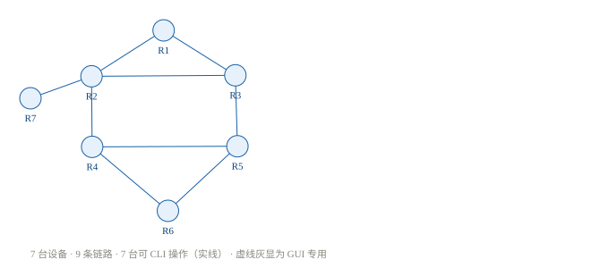

# ensp-copilot

> 让 Agent 配 eNSP，但每一条命令你都看得见。

**Python 3.10+ · 零第三方运行时依赖 · MIT · 非华为官方工具**



## 这是什么

一个跑在**你本机**的华为 eNSP 实验执行器。

把 `.topo` 交给它，用 eNSP 打开并启动设备；之后 Agent 下发的每条命令、设备返回的每个字节，都在浏览器窗口里实时滚动。不是日志回放，是**同一份真实 Console 字节流**——后端唯一持有那根 TCP 连接，把数据同时广播给窗口和命令执行器。

命令在下发前是 JSON 计划，可预览、可 diff、可回滚。默认只放行只读命令；`save`、`undo`、`reset` 这类动作需要显式确认。

> 本仓库**不分发** eNSP、VRP 或任何设备镜像。使用前需自行安装并合法持有华为 eNSP。

## 为什么做这个

eNSP 没有开放 API，设备 CLI 是内嵌窗口。让 AI「代敲命令」很容易，但会立刻撞上四件事：

| 痛点 | 后果 |
|---|---|
| Console 每台设备只允许一个 TCP 连接 | 用户开一个 CLI 窗口就把 Agent 踢掉；实时窗口自己 `connect()` 也会抢 |
| 命令一条条发，没有整体计划 | 配到一半发现方向错了，无法回滚、无法复现 |
| VRP 回显是给人看的文本 | 分页 `More`、等价路由续行、视图跨连接保留、GBK 编码 —— 机器解析极易误判 |
| AI 直接操作设备是黑盒 | 用户不知道改了什么，错了也不知道哪一步错 |

本项目把「**可审计**」放在「自动化」前面：先有计划，再执行；执行时全程可见；每步用 `display` 回读验证。

## 用户只做两步

1. 挑一个 `.topo` 方案（或放自己的），**双击用 eNSP 打开**
2. **全选设备 → 启动**，等 1–3 分钟，直到自检向导全绿

之后：提要求 → 预览 plan → 点「执行」→ 实时看命令与回显。

两个必须遵守的前提：

- **别双击任何设备的 CLI 窗口**（单会话，会抢占连接）
- 生成拓扑时只用 CLI 可操作设备（Router / Switch / 防火墙）。Server / Cloud 的服务配置是 GUI 对话框，一旦用上，「只做两步」就不成立了

## 和「eNSP MCP Server」不是一回事

MCP 是「AI 客户端 ↔ 工具」协议，不是「程序 ↔ 设备」协议。已有 eNSP MCP 项目的底层同样是通过 Telnet/裸 TCP 连 Console 端口。

| | 现有 MCP 项目 | 本项目 |
|---|---|---|
| 设备接入 | Telnet → Console 端口 | 一样（裸 TCP） |
| AI 集成 | MCP Server 暴露 tools | 可选 adapter，**不进核心** |
| 实时窗口 | RPC 模型不擅长推流 | **真实字节流 tee + SSE**，核心能力 |
| 执行方式 | 工具调用即下发 | plan JSON → dry-run → 确认 → 逐步验证 |
| 依赖 | 通常需 MCP Client | clone 后 `python` 直接跑 |

**定位是体验层 / 教学层，不是接入层。** 接入层不值得重复造。

## 快速开始

```bash
git clone https://github.com/oliegfoh/ensp-copilot.git
cd ensp-copilot
python -m ensp_copilot.server --port 8765
# 浏览器打开 http://127.0.0.1:8765
```

前置条件：

1. Windows 本机已安装并运行 eNSP，且已打开目标 `.topo`
2. 全部设备已启动完成（AR 约 1–3 分钟）
3. 没有其他程序占用设备 Console

页面提供：拓扑候选卡片（含离线 SVG 预览、设备类型与可操作性标识）、环境自检、实时回显、plan 预览。

## 核心设计：一个会话，多个订阅者

```
                ┌─ 浏览器 SSE（常驻订阅）
eNSP device ─── Session ─ Hub ─┼─ 命令执行器（临时订阅 + 写锁）
                └─ 日志 / 验证（常驻订阅）
```

`SessionManager` 是**唯一**持有 socket 的地方。`Hub.publish()` 把同一份字节流广播给所有订阅者；`write_lock` 保证同一设备一次只有一条命令在飞，避免回显串台。这是全项目最关键的约束。

自检**不盲信 `.topo` 里的 `com_port`**：该字段由 eNSP 分配、未公开，且不按设备编号排序（实测 R1=2006、R2=2000）。一律先做真实端口扫描 + 逐台 CLI 握手，再用拓扑指纹比对，防止用户打开了另一个方案。

## 现在能做什么

| 状态 | 能力 |
|---|---|
| ✅ 已实现 | `.topo` 解析与设备分类；离线 SVG 渲染；唯一会话 + tee 广播；SSE 实时窗口；环境自检与指纹比对；只读白名单 / 危险命令确认 / plan 校验 / 基线 diff；交互式 `save` |
| ✅ 已实现 | 5 份真实实验 plan（IP 编址 / OSPF / cost / IS-IS / BGP）可直接回放；23 个基于 fixtures 的单测，CI 不需要 eNSP |
| 🔧 规划中 | 按自然语言需求**生成多个 `.topo` 候选**（当前只提供 1 份示例拓扑 + 渲染器） |
| 🔧 规划中 | plan 逐步验证 / 失败即停 / 基线回滚；MCP adapter；`xterm.js` 终端渲染 |

上表刻意区分现状与规划——README 不替未完成的功能吹牛。

## 目录

```
ensp_copilot/
  topo.py       .topo XML → 设备、链路、坐标、类别、com_port、指纹
  console.py    裸 TCP 传输、视图规整、关分页、交互式 save
  session.py    核心：唯一连接 + Hub tee 广播 + 写锁
  render.py     离线 SVG（形状=设备类型，实线/虚线=能否 CLI 操作）
  env.py        自检：端口扫描 + CLI 握手 + 指纹比对
  safety.py     只读白名单、危险命令确认、plan 校验、基线 diff
  server.py     stdlib HTTP + SSE，零依赖本地窗口
web/            单页界面（候选卡片 / 自检 / 实时回显 / plan 预览）
plans/          5 份真实实验配置
fixtures/       真实设备回显，用于无 eNSP 的测试
topologies/     示例 .topo
docs/           架构、踩坑知识库、项目故事与对外文案
tests/          unittest，23 项
```

## 真实实验背书

项目骨架不是凭空设计的，来自一次完整的 7 台路由器实验：9 条 `/30` 链路、双 OSPF 域、IS-IS 办事处接入、两个 AS 的 IBGP 全互联 + 2 条 EBGP，最终 16/16 peer Established。`plans/` 与 `fixtures/` 就是那次实验留下的真实配置与回显。

过程中踩过的坑（等价路由续行误判、`save` 的 `[Y/N]` 交互、视图跨连接保留、`com_port` 不按编号……）都固化在 [`docs/pitfalls.md`](docs/pitfalls.md) 和测试里。

## 安全与边界（必读）

- **必须本机运行**：连接目标是 `127.0.0.1:<com_port>`，不是云端服务
- **Console 无认证、无加密**：eNSP 实测监听在 `0.0.0.0:2000+`，同网段任何人都能连上设备。**不要在不可信网络里使用**，也不要把端口映射到公网
- **设备侧操作是真实生效的**：不是沙盒。配错会影响你的实验；改路由策略有把自己锁在设备外的风险
- **不 `save` 就断电即丢**：工具默认不会替你保存，保存需显式确认
- **只支持 eNSP**：真机、EVE-NG、GNS3、HCL 不适用
- **依赖 GUI**：eNSP 主进程必须存活、设备必须已启动，无 headless 模式
- `com_port` 是 eNSP 未公开字段，版本变动可能失效；兼容性靠自检探测，不靠写死

## 测试

```bash
python -m unittest discover -s tests -v
```

23 项全部基于 `fixtures/`，无需 eNSP、无需网络。

## 文档

- [`docs/architecture.md`](docs/architecture.md) — 分层、唯一会话、请求路径、SSE 取舍
- [`docs/pitfalls.md`](docs/pitfalls.md) — VRP 解析陷阱知识库
- [`docs/story.md`](docs/story.md) — 项目缘起、设计取舍，以及可直接复用的对外文案

## License

MIT，仅覆盖本仓库代码。不含任何华为软件或镜像。
